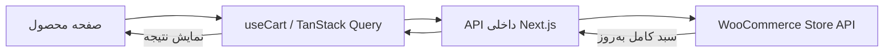

# راهنمای کوتاه ساخت سبد خرید با Next.js و ووکامرس

این راهنما برای بازسازی همین معماری در فروشگاه‌های بعدی است. مبنا: کد و آخرین آزمون‌های ثبت‌شده تا **۲۰۲۶/۱۰/۱۹**. همه صفحات در Next.js هستند و با API به وردپرس متصل می‌شوند.

**۱. هر بخش چه مسئولیتی دارد؟**

| بخش | مسئولیت |
| --- | --- |
| WooCommerce | نگهداری سبد و تعیین موجودی، تعداد مجاز و مبالغ |
| سرور Next.js یا BFF | اعتبارسنجی، نشست و ارتباط امن با ووکامرس |
| TanStack Query | نگهداری آخرین پاسخ سبد و هماهنگی نمایش‌ها |
| کامپوننت‌های React | دریافت انتخاب کاربر و نمایش داده، سایدبار و اعلان |

«ووکامرس منبع حقیقت است» یعنی مثلاً جمع مبلغ پس از کوپن را از پاسخ سرور می‌خوانیم. فرانت فقط آن را با توجه به واحد پول و `currency_minor_unit` قالب‌بندی می‌کند. قرارداد پاسخ در [Cart API ووکامرس](https://developer.woocommerce.com/docs/apis/store-api/resources-endpoints/cart/) آمده است.

**۲. با کلیک روی «افزودن به سبد» چه اتفاقی می‌افتد؟**



1. `ProductPurchase` شناسه محصول یا تنوع و ویژگی‌های واقعی انتخاب‌شده را مشخص می‌کند.
2. دکمه، `useCart().addItem` را صدا می‌زند؛ قیمت ارسال نمی‌شود.
3. تغییر وارد صف می‌شود و پیش از اجرا، دریافت قدیمی سبد لغو می‌شود.
4. درخواست `/api/cart/add-item` با Zod بررسی و به ووکامرس فرستاده می‌شود.
5. ووکامرس محدودیت‌ها را بررسی و سبد کامل را برمی‌گرداند.
6. پاسخ موفق با `setQueryData` جایگزین داده قبلی می‌شود؛ اعلان و سایدبار نمایش داده می‌شوند. این الگو در [راهنمای TanStack Query](https://tanstack.com/query/latest/docs/framework/react/guides/updates-from-mutation-responses) توضیح داده شده است.

هدر، سایدبار، سبد و تسویه با کلید مشترک `['cart', identity]` داده می‌خوانند. `identity` شناسه کاربر یا مقدار `guest` است. برای هر نمایش، سبد جدا نمی‌سازیم.

**۳. درخواست‌های اصلی کدام‌اند؟**

مسیرهای ووکامرس نسبت به `https://nrhstore.ir/wp-json/wc/store/v1` هستند. مرورگر فقط API داخلی را صدا می‌زند که با [Route Handlerهای Next.js](https://nextjs.org/docs/app/getting-started/route-handlers) ساخته شده است.

| کار | API داخلی Next.js | درخواست به ووکامرس | ورودی اصلی |
| --- | --- | --- | --- |
| دریافت سبد | `GET /api/cart` | `GET /cart` | ندارد |
| افزودن محصول | `POST /api/cart/add-item` | `POST /cart/add-item` | `id`, `quantity`, و برای تنوع `variation` |
| تغییر تعداد | `POST /api/cart/update-item` | `POST /cart/update-item` | `key`, `quantity` |
| حذف ردیف | `POST /api/cart/remove-item` | `POST /cart/remove-item` | `key` |
| خالی‌کردن سبد | `POST /api/cart/clear` | `DELETE /cart/items`، سپس `GET /cart` | `{}` |
| اعمال کوپن | `POST /api/cart/apply-coupon` | `POST /cart/apply-coupon` | `code` |
| حذف کوپن | `POST /api/cart/remove-coupon` | `POST /cart/remove-coupon` | `code` |
| ذخیره آدرس | `POST /api/cart/update-customer` | `POST /cart/update-customer` | `billing_address`, `shipping_address` |
| انتخاب ارسال | `POST /api/cart/select-shipping-rate` | `POST /cart/select-shipping-rate` | `package_id`, `rate_id` |
| انتقال سبد مهمان | `POST /api/cart/sync` | `POST /nrh/v1/cart/merge` | `{}`؛ توکن مهمان فقط در سرور خوانده می‌شود |
| پرداخت نهایی | `POST /api/cart/pay` | `POST /nrh/v1/checkout` | شناسه تلاش، هش سبد و مبلغ مورد انتظار؛ مبلغ و آدرس دوباره در سرور بررسی می‌شوند |

افزودن با شناسه محصول/تنوع و ویرایش و حذف با `key` ردیف انجام می‌شود. کنترل تعداد از `quantity_limits` شامل `minimum`، `maximum`، `multiple_of` و `editable` پیروی می‌کند؛ تأیید نهایی با ووکامرس است.

**۴. نشست، کش و درخواست‌های هم‌زمان چگونه مدیریت می‌شوند؟**

- Next، [Cart Token](https://developer.woocommerce.com/docs/apis/store-api/cart-tokens/) را از ووکامرس می‌گیرد و در کوکی `HttpOnly` نگه می‌دارد؛ سپس آن را در هدر درخواست ووکامرس می‌گذارد. توکن در اختیار JavaScript مرورگر قرار نمی‌گیرد.
- پس از رفرش، با کمک کوکی همان سبد از سرور خوانده می‌شود. کش Query محل ذخیره دائمی سبد نیست.
- `scope: { id: 'cart-writes' }` تغییرات همان QueryClient را صف می‌کند. Web Locks تب‌ها را هماهنگ و قفل فایل در Next، workerهای دارای دیسک مشترک را برای همان سبد محافظت می‌کند. خواندن خودکار هنگام تغییر متوقف می‌شود.
- `retry: false` جلوی افزودن دوباره در اثر تکرار خودکارِ درخواست نامطمئن را می‌گیرد؛ ابتدا سبد بازخوانی می‌شود.
- خطای `409` همراه `data.cart`، کش را با سبد سرور همگام می‌کند؛ در خطاهای دیگر، بازخوانی درخواست می‌شود.
- `BroadcastChannel` فقط به تب‌های دیگر خبر بازخوانی می‌دهد؛ توکن یا داده سبد را منتقل نمی‌کند.
- اولین نشست با GET ساخته می‌شود؛ POST بدون نشست پیش از نوشتن رد می‌شود. فقط همین خطای مشخص، bootstrap و یک تلاش تازه را مجاز می‌کند.
- هویت عملیات، نسخه فرم، آدرس برگشتی و سبد فعلی در تأیید نتیجه بررسی می‌شوند. [جزئیات اصلاح و تست دو تب](D:/Projects2/nrh_store_nextjs/docs/race-condition-fixes-fa.md).

کوکی مهمان و کاربر جداست و نشست روی سرور بررسی می‌شود. ادغام سبدها به قرارداد بک‌اند نیاز دارد؛ تغییر query key کافی نیست.

**۵. کدها را از کجا بخوانم؟**

فایل‌های همین پروژه را به ترتیب زیر بخوان:

| فایل | چیزی که یاد می‌گیری |
| --- | --- |
| [ProductPurchase.tsx](D:/Projects2/nrh_store_nextjs/features/products/components/ProductPurchase.tsx) | تبدیل انتخاب تنوع محصول به ورودی افزودن |
| [AddToCartButton.tsx](D:/Projects2/nrh_store_nextjs/features/cart/components/AddToCartButton.tsx) | اتصال دکمه و وضعیت انتظار به هوک |
| [use-cart.ts](D:/Projects2/nrh_store_nextjs/features/cart/hooks/use-cart.ts) | query، mutation، صف تغییرات و به‌روزرسانی کش |
| [cart.api.ts](D:/Projects2/nrh_store_nextjs/features/cart/api/cart.api.ts) | ارسال HTTP و تبدیل خطا به شکل قابل استفاده در UI |
| [contracts.ts](D:/Projects2/nrh_store_nextjs/features/cart/contracts.ts) | اعتبارسنجی ورودی با Zod؛ نوع‌های TypeScript به‌تنهایی اعتبارسنجی runtime نیستند |
| [handlers.ts](D:/Projects2/nrh_store_nextjs/features/cart/server/handlers.ts) | نشست، کوکی، کنترل درخواست و ارتباط با ووکامرس |
| [CartProvider.tsx](D:/Projects2/nrh_store_nextjs/features/cart/components/CartProvider.tsx) | وضعیت بازبودن سایدبار و اعلان؛ داده سبد در Query باقی می‌ماند |
| [Checkout.tsx](D:/Projects2/nrh_store_nextjs/features/cart/components/Checkout.tsx) | ذخیره آدرس، انتخاب ارسال و مرور سفارش داخل Next |

پیشنهاد کالا از `GET /api/cart/recommendations?ids=...` می‌آید؛ محصولات مرتبط کاتالوگ، با کنارگذاشتن کالاهای داخل سبد نمایش داده می‌شوند.

**۶. درس خطای `signal is aborted without reason` چه بود؟**

لغو درخواست ذاتاً اشکال نیست. خطای گزارش‌شده به `abort()` بنرها و نشست اشاره داشت؛ علت گزارش‌شدن آن به‌صورت `unhandled` قطعی نشد.

از الگوی [نادیده‌گرفتن پاسخ قدیمی در React](https://react.dev/learn/synchronizing-with-effects#fetching-data) استفاده کردیم: بنر بعد از unmount با `disposed` و نشست با شماره درخواست و بررسی state قبلی، جلوی اعمال پاسخ قدیمی را می‌گیرند. درخواست می‌تواند تمام شود. لغو خواندن‌های سبد توسط TanStack همچنان برقرار است.

**۷. در پروژه بعدی به چه ترتیبی بسازم؟**

1. قرارداد Store API، تنوع‌ها، واحد پول و افزونه‌های ورود/پرداخت را بررسی کن.
2. دریافت سبد و نشست سروری را بساز؛ رفرش و دو مرورگر مستقل را آزمایش کن.
3. کلاینت HTTP، قرارداد ورودی و هوک مشترک Query/Mutation بساز.
4. افزودن، ویرایش و حذف را بساز؛ هدر، سایدبار و سبد را به همان هوک وصل کن.
5. کوپن، آدرس و ارسال را با مبلغ‌های برگشتی ووکامرس اضافه کن.
6. ادغام سبد، checkout و درگاه را تکمیل کن؛ پرداخت روی سرور تأیید شود.
7. محدودیت تعداد، قطع شبکه، پاسخ دیررس، رفرش، چند تب و ورود با سبد مهمان را آزمایش کن.

فرمان‌های بررسی این پروژه:

```sh
npm run test:cart
npm run test:auth
npm run typecheck
npm run lint
npm run test:providers:browser
npm run test:cart:browser
```

تست مرورگر، سرور محلی و Playwright می‌خواهد؛ مسیر ماژول خارجی با `PLAYWRIGHT_MODULE` مشخص می‌شود. `test:cart:live` با ووکامرس واقعی کار می‌کند.

**۸. چه چیزهایی در همین پروژه هنوز تکمیل نشده‌اند؟**

به‌روزرسانی ۲۰۲۶/۱۰/۲۲: پرداخت سداد و انتقال سبد مهمان در رابط وردپرس ۱٫۱ پیاده‌سازی شده‌اند. سبد مهمان با Cart-Token و درخواست حساب با کوکی وردپرس و nonceهای WP/Store API کار می‌کند؛ این تغییر از انتخاب SessionHandler ناسازگار با Boom در تسویه حساب واردشده جلوگیری می‌کند. نصب رابط و آزمون خرید واقعی باقی است. مسیرهای سبد، تسویه و نشست باید از کش WordPress/CDN مستثنا شوند. جزئیات در [راهنمای فعلی تسویه](D:/Projects2/nrh_store_nextjs/docs/headless-checkout-sadad-fa.md) است.
